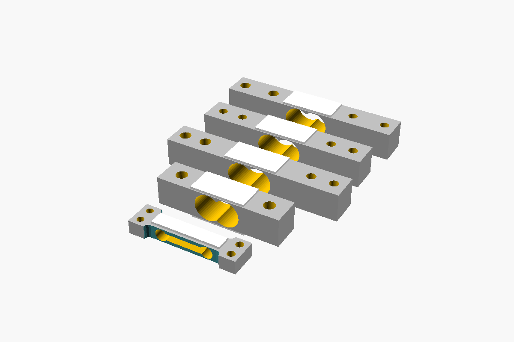
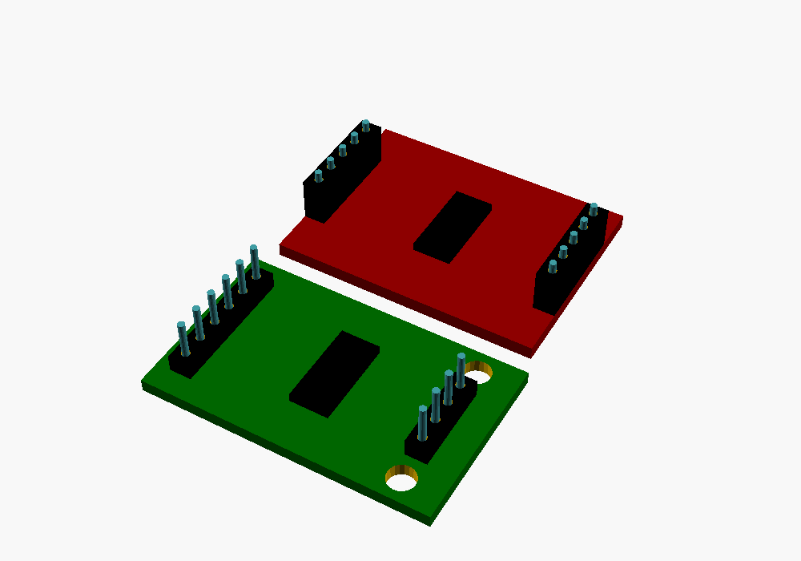

# load-cell-scad

OpenSCAD models of common bar load cells and HX711 amplifier boards, for
designing scales, mounts and enclosures around them. Each part is a data row,
so the hole positions you design against come from the same numbers that draw
the part.





## Use it

`include` the data file, which brings in the rows, then draw a row:

```openscad
include <load_cells.scad>
load_cell(LC_TAL220);

include <amplifier_boards.scad>
amplifier_board(AMP_HX711_generic);
```

Use `include`, not `use`: the `LC_*` and `AMP_*` rows and the `load_cells`
and `amplifier_boards` lists are variables. To draw every load cell:

```openscad
include <load_cells.scad>
for (i = [0:len(load_cells) - 1]) translate([0, i * 25, 0]) load_cell(load_cells[i]);
```

| Load cell | Bar (mm) | Mounting holes |
| --- | --- | --- |
| `LC_TAL220` | 80 × 12.7 × 12.7 | M5 at one end, M4 at the other |
| `LC_TAL220B` | 55 × 12.7 × 12.7 | one M5 at each end |
| `LC_TAL221` | 47 × 12 × 6 | two M3 at each end |
| `LC_komputer_10kg` | 75.2 × 12.7 × 12.7 | M4 at both ends |
| `LC_komputer_5kg` | 80.2 × 12.7 × 12.7 | M5 at one end, M4 at the other |

A load cell is centred on the origin, its length along x and its mounting
holes along z. `load_cell(type, load_cell_color, sensor_color)` sets the
colours.

The boards are `AMP_HX711_generic` (33.5 × 20.5 mm, a 6-pin and a 4-pin
header, two 3.15 mm mounting holes) and `AMP_HX711_sparkfun` (31.2 × 23.4 mm,
two 5-pin headers). A board lies on z = 0, centred on the origin.
`amplifier_board(type, headers, header_pin_length)` leaves the header blocks
out with `headers = false` and the pins out with `header_pin_length = 0`.


### Designing around a part

The accessors return a row's fields, so a mount can follow the part:

```openscad
include <load_cells.scad>

// Clearance holes for every mounting hole of a TAL220, in a 5 mm plate
difference() {
  cube([90, 20, 5], center = true);
  for (g = lc_screw_holes(LC_TAL220), p = [g[1], g[2]])
    translate([p.x, p.y, 0]) cylinder(d = g[0] + 0.4, h = 6, center = true);
}
```

Load cells: `lc_name`, `lc_cell_dims`, `lc_sensor_dims`, `lc_center_cutout`,
`lc_screw_holes`, `lc_side_cuts`. Boards: `amp_name`, `amp_pcb`,
`amp_colour`, `amp_chip`, `amp_headers`, `amp_mount_holes`, and
`amp_pin_ys(n)` for the pin positions in a header of n. The row formats are at
the top of `load_cell.scad` and `amplifier_board.scad`; add a part by adding a
row to `load_cells.scad` or `amplifier_boards.scad` and to its list.

## Checks

`just test` takes about 3 s on OpenSCAD 2026.10.15. For every load cell it
checks that:

- it renders as one piece, the bar plus its two gauges;
- every mounting hole, both bores, and the TAL221's slot and side notches go
  right through at their stated size: a pin 0.05 mm under size passes and one
  0.2 mm over doesn't;
- each hole keeps at least 1 mm of metal to the bar's ends, sides and bores;
- the gauges cover the bending section.

For each board it checks its size, that every header pin passes through its
hole, and that the mounting holes go through at their stated size.

`just images` renders the pictures.

## Licence

MIT; see [LICENSE](LICENSE).
